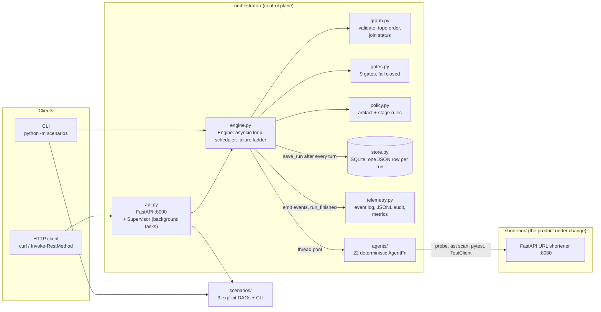
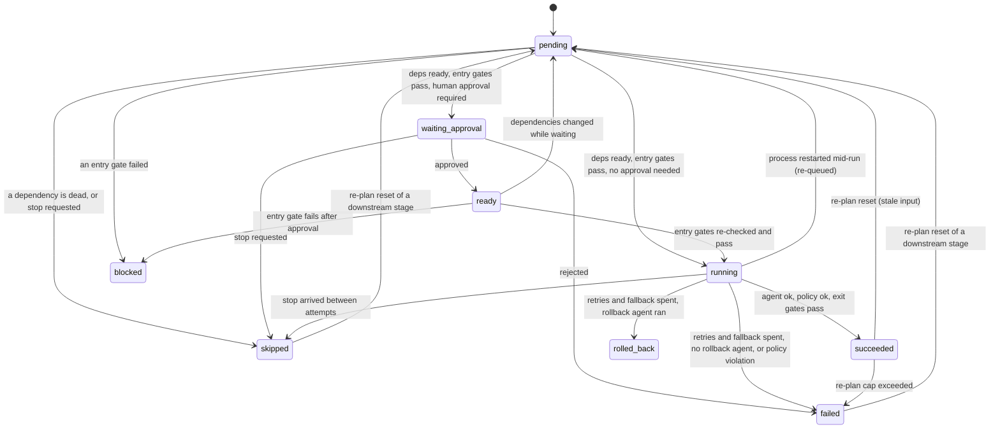
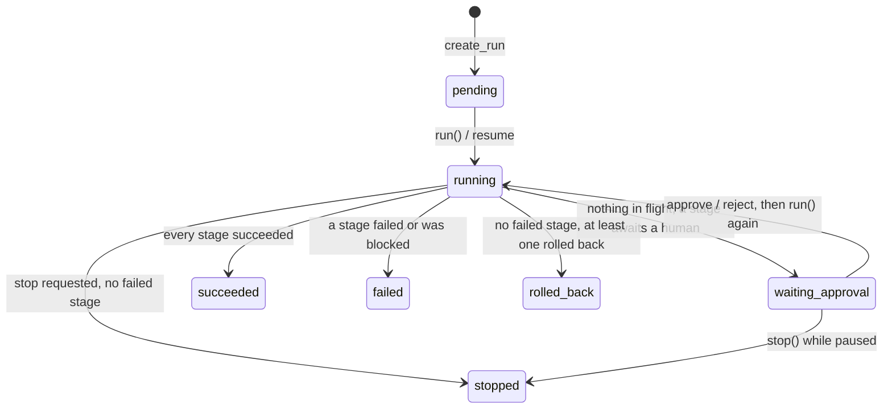
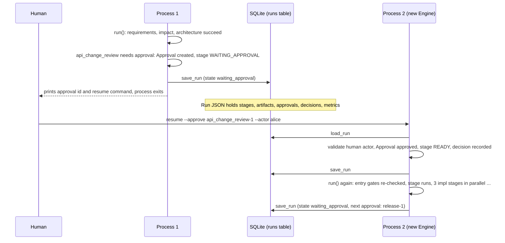

# Architecture

This document describes what the code does today. Where a behaviour is a limitation or an approximation, it says so. File references are to the repository root; the entry point is [README.md](README.md), real run output is in [docs/SCENARIOS.md](docs/SCENARIOS.md).

Contents: 1 Components, 2 Orchestration model (stage and run state machines), 3 Control flow and pause/resume, 4 Gates, 5 Parallelism and join, 6 Failure-handling ladder, 7 Approvals and autonomy, 8 Policy engine, 9 Re-plan, 10 Observability and metrics, 11 Persistence, 12 HTTP API, 13 Agent design, 14 Key decisions and alternatives, 15 Scaling to production.

## 1. Components



Two Python packages carry the system, and a third is the thing being worked on:

| Package | Role |
|---|---|
| `orchestrator/` | Generic engine. Knows stages, artifacts, gates, approvals, policy; knows nothing about URL shorteners (agents and scenarios are injected). |
| `scenarios/` | The three workflows as data (`list[StageSpec]`), the CLI, and plain-text reporting. |
| `shortener/` | The product. Agents read it (`ast`), call it (in-process `TestClient`), and test it (`pytest tests/shortener`). `shortener/manifest.py` is a machine-readable description of it; a test keeps the manifest in sync with the code. |

The engine depends only on three Protocols in `orchestrator/contracts.py` (`RunStore`, `TelemetrySink`, `Orchestrator`), so the store and telemetry are replaceable and testable in isolation. Defaults are an in-memory store and a null telemetry sink; the CLI and API wire in SQLite and the real `Telemetry`.

## 2. Orchestration model

A **run** is one execution of a **graph**: a `list[StageSpec]` (`orchestrator/models.py`). A stage is declarative:

| Field | Meaning |
|---|---|
| `id`, `title`, `agent` | identity, and the key of the agent function to call |
| `depends_on`, `join` | edges; `join="all"` (default) needs every dependency succeeded, `"any"` needs one |
| `entry_gates`, `exit_gates` | names of gates evaluated before and after the agent |
| `max_attempts`, `backoff_ms` | bounded retries (default 2 attempts, 50 ms base, doubling) |
| `fallback_agent`, `rollback_agent` | tried once after retries; run once when the stage finally fails |
| `requires_approval`, `approval_kind`, `autonomy` | human checkpoint, its category, autonomy level |
| `consumes` | artifact names the stage reads; drives re-plan |
| `timeout_ms`, `parallel_group` | per-attempt wall-clock limit; informational label |

`create_run` validates the graph (no duplicate ids, no unknown or self dependencies, valid `join`, `max_attempts >= 1`, no cycle), runs the stage-level policy rules over every spec, and checks that every named agent is registered. A violation raises before any run exists (the API answers 422 `invalid_graph` or `policy_violation`).

### Stage state machine

States (`StageState`): `pending`, `ready`, `running`, `waiting_approval`, `succeeded`, `failed`, `rolled_back`, `skipped`, `blocked`. The last five are terminal for the stage (until a re-plan resets them).



"Dead" dependency states, used for skip propagation (`graph.DEAD_STATES`): `failed`, `rolled_back`, `blocked`, `skipped`. With `join="all"` one dead dependency makes the stage `skipped`; with `join="any"` the stage is skipped only when all dependencies are dead.

A rejected approval makes the stage `failed` (nothing ran, so there is nothing to roll back) and its dependents become `skipped`.

### Run state machine

States (`RunState`): `pending`, `running`, `waiting_approval`, `succeeded`, `failed`, `stopped`, `rolled_back`.



`Engine._settle` decides the terminal state with this precedence: any `failed` or `blocked` stage gives `failed`; otherwise any `rolled_back` stage gives `rolled_back`; otherwise all `succeeded` gives `succeeded`; otherwise `stopped` if a stop was requested; otherwise `failed`. A consequence: a policy violation, which triggers an automatic safe-stop, still ends the run as `failed`, because the offending stage is `failed`. `stopped` is reserved for stops that did not coincide with a stage failure.

## 3. Control flow of a run

`Engine.run(run_id)` executes until the run is terminal or paused for approval, then returns. It is one asyncio loop (`_drive`):

```text
_drive(run):
    first call: set metrics.started_at, telemetry.run_started   |  later calls: record "run resumed"
    state = RUNNING;  re-queue any stage left RUNNING by a crash (_recover_interrupted)
    loop:
        if stop_requested: skip every stage not yet started
        else: for stage in topological order:             # _advance
                  PENDING/READY stage with dependency status
                      DEAD  -> SKIPPED (cascades in the same pass)
                      READY -> evaluate entry gates -> BLOCKED on failure
                               -> approval needed? create Approval, WAITING_APPROVAL, no launch
                               -> otherwise launch as an asyncio task
        save_run(run)
        if no task in flight: break
        wait for FIRST_COMPLETED of (stage tasks, wake event)    # event-driven, no polling
        process finished stages in topological order (re-plan check)
    _settle(run)  -> WAITING_APPROVAL or a terminal state;  save_run(run)
```

The `wake` event is how `approve()` and `stop()` interrupt a loop that is waiting on slow stages: they mutate the live run and set the event.

### Pause and resume across processes



Everything the engine needs is inside the `Run` object (pydantic, serialised as one JSON document), so there is no in-memory state to lose. `started_at` and the metrics survive the pause, which is why `e2e_latency_ms` of a run includes the time it spent waiting for people (see section 10). The tests that cover this create a second `Engine` on the same store (`test_approval_pauses_run_and_resumes_after_restart_with_new_engine`), and the CLI does it for real because every `resume` is a new process.

What does not exist: a startup scan that resumes runs which were `running` when a server crashed. The engine can recover them (`_recover_interrupted` puts a `running` stage back to `pending`), but someone has to call `run()` again; the CLI does it with `resume <run_id>` and no flags. The HTTP API has no resume endpoint.

## 4. Gates

A gate is a pure function `GateContext -> GateResult` (`orchestrator/gates.py`). The context is a deep-copied snapshot: artifacts, stage states, run params, approvals. A gate checks evidence; it never acts.

| Gate | Passes when | Used as |
|---|---|---|
| `requirements_complete` | `problem`, `acceptance_criteria`, `assumptions` all non-empty | exit of `requirements`; entry of `architecture`, `impact`, `normalize` |
| `ambiguity_resolved` | every `open_questions` entry has a non-empty `resolution` (reads `normalized_requirements`, else `requirements`) | entry of `architecture`; exit of `apply_interpretation` |
| `impact_mapped` | impact analysis lists at least one impacted module | exit of `impact`; entry of brownfield `architecture` |
| `architecture_present` | at least one component | exit of `architecture`; entry of `api_change_review` and every `impl_*` |
| `implementation_complete` | `implementation.status == "ok"` | exit of `sync`; entry of `testing`, `documentation` |
| `tests_green` | `failed == 0` and `passed > 0` (an empty suite is not green) | exit of `testing` |
| `docs_present` | documentation lists at least one file | exit of `documentation`; entry of `release` |
| `release_ready` | tests green and no other stage is `failed`, `rolled_back` or `blocked` | entry of `release` |
| `no_policy_exceptions` | no `security_exception` approval is unapproved | entry of `release` (no scenario requests one; it is structural) |

Semantics:

- **Entry gates** run when a stage's dependencies are satisfied. A failing entry gate sets the stage `blocked` immediately (no retry, no waiting) and its dependents are skipped. After a human approves a stage, its entry gates are evaluated again, because evidence may have changed during the wait (`_admit(approved=True)`).
- **Exit gates** run inside the attempt, against the artifacts the agent is about to publish (an overlay on top of the run's artifacts). A failing exit gate makes the attempt fail, which feeds the retry ladder. Nothing is published unless policy and every exit gate pass, so a failed attempt leaves no partial artifacts.
- **Fail closed** (`run_gates`): a gate name that is not in the registry fails, and a gate that raises an exception fails. Neither can be read as a pass.
- Every gate evaluation is recorded as a decision (`kind="gate"`, with gate name, phase and details), pass or fail.

## 5. Parallelism and the join model

Stages with no unmet dependency are launched in the same scheduling pass, each as an `asyncio` task. In the scenarios: three `impl_*` stages run in parallel after `architecture` (or `api_change_review`), and `testing` and `documentation` run in parallel after `sync`.

```text
event loop thread                          worker threads (ThreadPoolExecutor, max_workers=6)
-----------------                          ---------------------------------------------------
build AgentContext (deep copy of artifacts)
run_in_executor(agent, ctx)  ------------> agent(ctx) -> AgentResult        (pure function of ctx)
await result  <---------------------------
policy.check_artifact, exit gates, publish artifacts, change stage state, append decisions, metrics
```

The rule that makes this safe without locks: agents only return a value. Every mutation of the `Run` (state transitions, artifact publication, decisions, metrics, approvals) happens on the event-loop thread, between awaits. Agents receive a deep copy, so an agent that mutates its context cannot affect the run (`test_agent_cannot_mutate_the_run_through_its_context`). The telemetry sink and SQLite store do take locks because they can be called from other contexts, but the engine itself does not.

Join: `sync` has `join="all"` and depends on all `impl_*` stages, so it starts only when every part has succeeded. If one part fails, `sync` is skipped and so is everything after it; independent branches keep going (`test_failure_in_one_branch_does_not_stop_independent_branch`). `join="any"` is implemented and tested but not used by the shipped scenarios.

Finished stages are processed in topological order, so scheduling is deterministic even though completion order is not.

Caveat: if more than six agent calls were ready at once, the extras would queue inside the executor, which the engine does not account for. The shipped graphs never exceed three.

## 6. Failure-handling ladder

Per stage, exactly this sequence (`_execute`, `_attempts`, `_attempt`, `_fail`):

```text
attempt (agent call, optional timeout) -> policy check on each artifact -> exit gates -> publish
   |
   | any failure (exception, wrong return type, timeout, exit gate fail)
   v
RETRY      up to max_attempts with the primary agent.
           delay before attempt n+1 = backoff_ms * 2^(n-1)   (50 ms, 100 ms, ...)
           metrics.retries += 1 for each retry that is scheduled
   |  all attempts failed
   v
FALLBACK   if fallback_agent is set: one attempt with it (same policy and gates).
           metrics.fallbacks += 1; stage.used_fallback = True
   |  fallback failed (or none defined)
   v
ROLLBACK   if rollback_agent is set: run it once with the failure in its params.
           success -> stage ROLLED_BACK, metrics.rollbacks += 1
           the rollback agent itself raises -> stage FAILED (error says "rollback also failed")
           no rollback agent -> stage FAILED
   |
   v
SAFE-STOP  dependents are SKIPPED (dead dependency); independent branches continue;
           run ends rolled_back or failed (section 2).
```

Details a reviewer should know:

- A policy violation skips the ladder entirely: no retry, no fallback, no rollback agent. The stage is `failed` and the run is put into safe-stop (section 8).
- An entry-gate failure is not retried; it blocks.
- `timeout_ms` bounds one attempt. Python cannot kill a thread, so on timeout the engine stops waiting and counts the attempt as failed, but the agent keeps running until it returns and its late result is discarded (documented in `engine.py` and `StageSpec`).
- A fallback is a different action nobody approved, so a stage that needs approval may not define one (policy rule `fallback_requires_own_approval`, enforced at `create_run`).
- Rollback here is deliberately modest and honest about what it undoes: `rollback_testing` records that no `test_report` was published (that absence keeps the release gate closed); `rollback_release` deletes the generated release checklist file and says that nothing was deployed. Neither pretends to revert a deployment, because there is none.
- In the scenarios only `testing` (3 attempts, `testing_fallback`, `rollback_testing`, 120 s timeout) and `release` (1 attempt, `rollback_release`) have the full ladder; other stages default to 2 attempts and fail directly.
- **Safe-stop** (`Engine.stop`, `POST /runs/{id}/stop`): the in-flight stages finish; between attempts the engine checks `stop_requested` and abandons remaining retries, the fallback and the rollback launch; stages not yet started become `skipped`; pending approvals are cancelled (status `rejected`, actor `engine`).

Failure injection for demonstration is a run param read by the testing agents: `testing` (attempt 1 fails), `testing_hard` (every primary attempt fails, fallback works), `testing_all` (fallback fails too). It is the only place agent code is aware of the ladder, and it exists so the ladder can be shown deterministically.

## 7. Approvals, autonomy, and demo mode

**Approval model.** A stage needs a human when `requires_approval` is set, or its autonomy is `human_gated`, or its `approval_kind` is in the high-impact set (`schema_change`, `public_api_change`, `production_release`, `security_exception`). The engine creates an `Approval` (id `<stage>-<n>`, kind, status `pending`) stored inside the run, marks the stage `waiting_approval`, and carries on with other branches. When nothing else is in flight the run is saved as `waiting_approval` and `run()` returns.

`approve` or `reject` takes an `actor` (mandatory, stripped, non-empty) and an optional comment:

- Approved: stage becomes `ready`, entry gates are re-checked, the stage runs.
- Rejected: stage becomes `failed` with `approval rejected by <actor>: <comment>`; dependents are skipped; the run ends `failed`.
- Resolving an unknown or already-resolved approval raises (HTTP 404 or 409).
- If a run is paused for approval and is stopped, its pending approvals are cancelled.
- The decision is recorded with actor, kind and comment in the decision lineage.

Machine actors (`auto-approver`, `demo-auto-approver`, `engine`, `system`, and the configured auto-approver's name) are reserved: a human decision cannot be attributed to them, case-insensitively, over the CLI, the engine or HTTP.

What the system cannot enforce: that the approver is a different person from whoever requested the change, and that the actor string is a real identity. Both need an identity provider in front of the API (section 15).

**Autonomy levels** (`Autonomy`):

| Level | Meaning | What the engine does with it |
|---|---|---|
| `full` | agent acts alone | nothing special, except policy forbids it on release stages |
| `supervised` (default) | agent acts, humans can watch and stop | same as `full` at runtime; the difference is intent, and the stop endpoint |
| `human_gated` | agent must wait for approval | stage needs a human before it runs |

To be plain about it: only `human_gated` (and `requires_approval`, and high-impact kinds) change engine behaviour. `full` versus `supervised` is a label that policy reads in one place. The controls that carry weight are the approval requirement, the policy rules, and gates.

**Demo mode (`--auto-approve`)** is an `AutoApprovePolicy(kinds, actor)` passed to the `Engine` constructor. The CLI builds it with `kinds={"*"}` and actor `demo-auto-approver`, and prints `*** DEMO MODE: all approvals auto-granted (no human review) ***`. With it, the engine still creates a real `Approval` and a decision record, marked approved by the machine actor, so the audit trail shows exactly who "approved".

It is operator configuration and not a run parameter on purpose. Everything in `run.params` is client-controlled input (the API merges request params into it, and agents read it). If a param could switch approvals off, any API caller could bypass the human checkpoints. So:

- The engine takes the switch only from its constructor; it never reads `run.params` for it (`test_run_params_can_never_enable_auto_approve`).
- `create_default_app` builds the engine with no auto-approve policy, so the HTTP service cannot be started in demo mode by a request.
- The API additionally rejects `params.auto_approve` with 422 `auto_approve_not_allowed`, so a client gets a clear error rather than a silently ignored key.
- The machine actor names are reserved, so a human cannot be impersonated by the demo identity, nor the reverse.

## 8. Policy engine

`orchestrator/policy.py`. Rules are small named functions that raise `PolicyViolation(rule, message)`; they sit in two lists, so adding a rule is one line. Messages name the rule and the field path, and never echo the value.

| Rule | Level | Effect |
|---|---|---|
| `no_secrets` | artifact | rejects credentials: AWS key ids, PEM private key blocks, JWT-shaped tokens, AWS-style 40-character secrets next to an `aws` or `secret` hint, credentials in `Authorization` headers, `password = "x"` style assignments inside text, and fields named like secrets (`password`, `api_key`, `client_secret`, `token`, ...) holding a literal. Placeholders (`${NAME}`, `<redacted>`, `***`, `REDACTED`, empty) are accepted. |
| `safe_destination_urls` | artifact | rejects `javascript:`, `data:`, `file:`, `vbscript:`, `blob:`, `about:` under any URL-like key (`url`, `href`, `redirect`, `target`, `callback`, ...) and in `href=` or `src=` attributes inside strings; whitespace and control characters inside the scheme are ignored, as browsers do |
| `high_impact_needs_approval` | stage | a stage with a high-impact `approval_kind` must set `requires_approval` |
| `release_not_fully_autonomous` | stage | a stage that looks like a release (id, agent or kind) may not use `autonomy=full` |
| `fallback_requires_own_approval` | stage | a stage that needs approval may not define a `fallback_agent` |

Stage rules run at `create_run`, so a violating graph never starts. Artifact rules run on every artifact of every attempt, before exit gates. An artifact violation is a **hard stop**: the stage is `failed` without retry, fallback or rollback; the engine sets `stop_requested`, so in-flight stages finish and everything unstarted is skipped; the run ends `failed`. A real example, from running the engine with an agent that emits `{"db": {"password": "..."}}`:

```text
policy  fail       literal secret value found in artifact 'config' field 'db.password'   {'rule': 'secret_detected'}
stop    requested  policy violation triggered an automatic safe-stop
stop    skipped    run is stopping; stage never started
```

The secret rules are heuristics (regular expressions and key-name matching), tuned against 320 test cases; they will have both false positives and false negatives, and are a guardrail, not a data-loss-prevention product.

## 9. Re-plan

"Re-plan" here means invalidation and re-execution of work built on outdated input. It does not invent new stages.

Algorithm (`_maybe_replan`, `_replan_if_self_stale`, `_replan`):

1. When a stage starts, `_begin` records `input_hashes`: for each name in `spec.consumes`, the `sha256` of the artifact it sees (empty if the artifact does not exist yet).
2. Artifacts are fingerprinted with `fingerprint()` (SHA-256 of canonical JSON, first 16 hex chars). When a stage publishes, each artifact gets a new version, and the artifact counts as *changed* only if its hash differs from the previous one. Republishing identical content triggers nothing.
3. When a stage succeeds with changed artifacts, every other `succeeded` stage whose recorded hash for one of those names differs from the current hash is **stale** (`_stale_inputs`).
4. Each stale stage and everything downstream of it (`graph.downstream`) is reset to `pending`: attempts and error cleared, input hashes cleared, pending approvals on it cancelled ("superseded by re-plan"). Stages that are `pending` or `running` are left alone. `StageRuntime.runs` keeps counting executions.
5. A stage that was `running` while its input changed is caught when it finishes: `_replan_if_self_stale` compares its recorded hashes with the current ones and resets it instead of accepting a result built on stale data.
6. `metrics.replans += 1` and a decision `kind="replan"` records which stage consumed which outdated artifact (consumed hash versus current hash) and which stages were reset.
7. **Cap, fail loud:** each source stage may cause at most `MAX_REPLANS = 3` applied re-plans. A fourth attempt does not silently continue: the stale `succeeded` stages are set to `failed` with error `stale_after_replan_limit`, a decision with outcome `limit_exceeded` is recorded, and the run ends `failed`.

Honest status: the three shipped scenarios do not trigger a re-plan, because each artifact is published once (their runs show `replans=0`). The one exception to "published once" is `normalized_requirements` in the ambiguous scenario, which is republished by `apply_interpretation`; its only consumer is the stage that republishes it, so nothing is stale. The mechanism is covered by engine tests (`test_replan_resets_downstream_when_upstream_artifact_changes`, `test_replan_limit_fails_the_run_loudly_instead_of_continuing_with_stale_work`, `test_replan_cap_is_per_source_stage`, `test_running_consumer_that_finishes_on_stale_input_is_replanned`, `test_no_replan_when_consumer_already_saw_current_artifact`). Also, `consumes` only drives re-plan; it is not an access list, and agents can read every artifact in the run.

## 10. Observability

There are two complementary records, written by the same call (`Engine._record`):

| | Decision lineage | Telemetry trace and audit file |
|---|---|---|
| Object | `Run.decisions: list[DecisionRecord]` | `Telemetry` event log, and `data/audit.jsonl` |
| Stored | inside the run JSON, in the store | bounded in-memory deque (5000 events, per process) and an append-only JSONL file, flushed per event |
| Survives restart | yes, with the run | the JSONL file does; the in-memory part does not |
| Purpose | answer "why did the run do this?" for one run | operational trace and a durable, cross-run audit file |
| Shape | `ts, run_id, stage_id, kind, rationale, outcome, inputs` | `ts, run_id, stage_id, event, details{outcome, rationale, ...inputs}` |

Decision kinds in use: `start`, `stage`, `gate`, `artifact`, `retry`, `fallback`, `rollback`, `approval`, `policy`, `stop`, `replan`, `finish`. Every decision carries a rationale (`test_every_decision_has_a_rationale`). The `inputs` make the lineage checkable: gate decisions carry the gate name, phase and details; `artifact` decisions carry sha256 and version; `stage started` carries the input hashes the stage saw; approvals carry actor and kind; re-plan decisions carry consumed and current hashes. Together they answer "which evidence did stage X act on, who approved it, and which version of each artifact was it".

`python -m scenarios trace <run_id>` prints the decisions; `GET /runs/{id}/trace` returns both the telemetry events and the decisions. One consequence worth knowing: after an API restart the telemetry half of `/trace` only has events from the current process, while `decisions` is complete (it lives in the run); the JSONL file has everything.

### Metrics

Computed by `Telemetry.run_finished` when a run reaches a terminal state, and exposed as JSON or Prometheus text (`GET /metrics`, `python -m scenarios metrics`).

| Metric | Definition |
|---|---|
| `success_rate` | runs `succeeded` / runs finished (`succeeded + failed + stopped + rolled_back`) |
| `retries_total`, `retry_rate_per_run` | retries scheduled across runs; and that total divided by finished runs |
| `fallbacks_total`, `rollbacks_total` | counts of fallback attempts and rollback agent executions |
| `rollback_rate` | share of finished runs that ended `rolled_back` (not rollbacks per run) |
| `mttr_ms` | mean over runs that ended `succeeded` after at least one retry, fallback or rollback decision, of `run.ended_at - ts(first such decision)` |
| `avg_e2e_latency_ms`, `p95_e2e_latency_ms` | wall clock from first start to terminal state, mean and nearest-rank 95th percentile |
| `avg_active_ms` | mean of `e2e_latency_ms - approval_wait_ms` |
| `replans_total`, `approvals_requested_total` | counts |

Notes on interpretation, stated as plainly as the code states them (`orchestrator/telemetry.py` docstring):

- **MTTR is an approximation.** The first recovery decision is recorded when the engine reacts to a failure, slightly after the failure itself, and the measure covers recovery of the whole run, not of the single stage; the engine stores no separate "first failed at" timestamp. It also only samples runs that recovered, so a run that never recovered contributes nothing (the metric flatters). And because `ended_at` includes any human approval wait that happens after the recovery (for example the release approval), MTTR for human-gated runs includes that wait. For auto-approved runs it is a few hundred milliseconds; the injection runs in docs/SCENARIOS.md show 166 ms.
- **`e2e_latency_ms` includes human time.** It spans first start to final state, across pauses and process restarts; a brownfield run with two approvals showed e2e 10,164 ms of which 9,874 ms was waiting for a person. `approval_wait_ms` is the time during which at least one approval was pending (overlapping waits counted once) and `active_ms` is the remainder, which is the number to use when asking how long the system itself worked. `active_ms` still contains retry backoff sleeps.
- The in-memory aggregates are per process. `python -m scenarios metrics` rebuilds them from all stored runs, so it survives restarts; the API's `/metrics` starts again at zero after a restart (for example `runs_started` can be lower than `runs_succeeded`).

## 11. Persistence

`orchestrator/store.py`. The unit of persistence is the whole `Run`, serialised with `model_dump_json()` into one row of a SQLite table `runs(id, state, scenario, created_at, updated_at, body)`, upserted by `save_run`.

- The engine saves after each scheduling turn, after every approval, on stop, and when a run settles, so a crash loses at most the in-flight turn; a stage found `running` after a restart is re-queued (agents are re-runnable by design).
- A stored run is always a copy (loaded from JSON), so callers can never mutate persisted state by accident.
- File databases use WAL; one connection shared across threads with a re-entrant lock around every statement.
- The schema lives in one place, the pydantic models; the SQL columns exist only for listing and filtering.
- The CLI uses `data/runs.db`, the API uses `data/orchestrator.db`; both append to `data/audit.jsonl` by default. The shortener product can persist links to a JSON file (`SHORTENER_DATA_FILE`), which is a product concern, separate from run state.

Known limitation: there is no compare-and-swap. Two processes resuming the same run at the same time would be last-writer-wins. Inside one process the engine refuses a second `run()` on a live run, and the API returns 409 for an approval already being resolved. Another documented gap: if a stage that needed approval is interrupted mid-run by a restart, it is re-queued and asks for a new approval even though the earlier one was granted.

## 12. HTTP API surface

Orchestrator (`orchestrator/api.py`, port 8090, OpenAPI at `/docs` and in `docs/openapi.orchestrator.json`). Routes are `async def` and only translate HTTP to engine calls; a `Supervisor` owns the background tasks so long operations return `202` immediately.

| Method and path | Purpose |
|---|---|
| `GET /health` | liveness |
| `GET /scenarios` | scenarios with their full stage graph (the explicit DAG as data) |
| `POST /runs` | create and start a run in the background. Body: `scenario`, optional `requirement`, optional `params` (merged over the scenario defaults). `202` with links; with `?wait=true&timeout=N` blocks until the run is terminal or waiting for approval and returns the full view (`200`) |
| `GET /runs`, `GET /runs/{id}` | list (newest first, `?state=`) and detail (`?include_content=true` adds artifact bodies) |
| `POST /runs/{id}/approvals/{approval_id}/approve` and `/reject` | body `{actor, comment}`; `actor` mandatory; same `?wait=` behaviour |
| `POST /runs/{id}/stop` | safe-stop; `409` if the run is already terminal |
| `GET /runs/{id}/trace` | telemetry events plus decision lineage |
| `GET /runs/{id}/dag` | nodes with current state, and dependency edges |
| `GET /metrics` | JSON snapshot, or Prometheus text with `?format=prometheus` |

Errors always use `{"error": {"code", "message"}}`: `unknown_scenario`, `auto_approve_not_allowed`, `policy_violation`, `invalid_graph`, `invalid_actor`, `validation_error` (422); `run_not_found`, `approval_not_found`, `not_found` (404); `approval_not_pending`, `run_already_finished` (409). If a background task crashes, the `Supervisor` logs it and records the run as `failed` with a `finish` event and cancels pending approvals, instead of letting the failure vanish with the task.

The shortener (`shortener/app.py`, port 8080) exposes `GET /health`, `POST /api/v1/urls` (rate limited, idempotency key, optional alias and ttl), `GET`, `PATCH`, `DELETE /api/v1/urls/{code}` (soft delete), `GET /api/v1/urls/{code}/analytics`, and `GET /{code}` (302 redirect that records a click). Its error body uses the same `{error: {code, message}}` shape.

## 13. Agent design

An agent is a plain function with one signature (`orchestrator/models.py`):

```python
AgentFn = Callable[[AgentContext], AgentResult]
# AgentContext: run_id, stage_id, scenario, requirement, attempt, is_fallback, artifacts (deep copy), params
# AgentResult:  artifacts: dict[name, dict], summary: str
```

The 22 registered agents (`orchestrator/agents/__init__.py`) are deterministic: no network, no model call, no API key. They derive their output from the requirement text and from the real shortener code.

| Agent | Produces | What it actually does |
|---|---|---|
| `requirements` | `requirements` | Detects features with a regex table (`agents/features.py`); emits problem, goals, Given/When/Then criteria, non-goals, assumptions, ambiguity flag. If no feature matches, it emits open questions instead of guessing. |
| `normalize`, `apply_interpretation` | `normalized_requirements` | Propose one bounded answer per open question; after human approval, write the answers in and add the features they imply. |
| `impact` | `impact` | Parses `shortener/*.py` with `ast`, builds a function index and a name-based call graph, finds the call path from each HTTP handler to the code a feature relies on, and lists impacted modules, regression risks, tests to re-run and public API deltas. Name-based matching over-approximates ("might touch"), and it says so. |
| `architecture` | `architecture` | Components (marking which already exist when impact is known), data model changes, API deltas, ADR-style decisions, constraints. |
| `api_change_review` | `api_change_review` | After approval, records exactly which changes were approved and whether they are breaking. |
| `impl_api`, `impl_store`, `impl_analytics`, `impl_alias`, `impl_ttl`, `impl_ratelimit`, `impl_ssrf` | `impl_<x>` | Call the real shortener code with sample inputs and record `{check, input, expected, actual, ok}` evidence. |
| `impl_audit`, `impl_retention` | `impl_<x>` | No code exists for these features, so they publish a design with `design_only: true`, `verified: false`; their only evidence is about the code they would build on. |
| `sync` | `implementation` | Merges the `impl_*` artifacts; raises if any part failed or none exist. |
| `testing`, `testing_fallback`, `rollback_testing` | `test_report` | Runs `pytest tests/shortener` in a subprocess plus a live in-process smoke test (6 checks); the fallback runs 3 smoke checks only; rollback records what it undid. |
| `documentation` | `documentation` | Writes `CHANGELOG.md`, `API.md`, `DESIGN.md` under `docs/generated/<run_id>/` (run id sanitised so it cannot escape the folder). |
| `release`, `rollback_release` | `release_checklist` | Builds a go/no-go checklist from the run's evidence, lists open risks, rollback plan and required approvals; writes it to disk and raises if no-go. Rollback deletes the file. |

Properties that matter to the engine:

- **Evidence-producing.** Agents publish what they checked, not just a verdict. Gates then check the evidence (for example `tests_green` reads the counts in `test_report`).
- **Idempotent and re-runnable.** Required because a stage may run again after a retry, a restart or a re-plan.
- **Pluggable.** The engine only calls `agents[name](ctx)`. An LLM-backed agent is a function with the same signature; registering it under the same name replaces the deterministic one. Because the policy engine, the exit gates, the attempt timeout and the retry ladder wrap every call, a model's output would pass through the same control plane as today's.

**No LLM is used in this build.** The reasons are deliberate: the subject under review is the control plane (gates, approvals, failure handling, audit), and deterministic agents make every scenario reproducible, runnable offline, testable in CI, and able to show exact failure behaviour via injection. The cost is real: "requirement understanding" is a regex feature table, so it recognises only the seven features it knows (`alias`, `ttl`, `analytics`, `rate_limit`, `ssrf`, `audit`, `retention`); the decomposition is authored rather than generated; and "implementation" verifies code that already exists rather than writing new code. What would need to be added for a real model: structured output validated against a schema (an exit gate that rejects malformed output), prompt and model version in the decision lineage, token and cost budgets, and a different retry policy for nondeterministic output (section 15).

## 14. Key decisions and alternatives considered

| Decision | Chosen | Alternatives | Why this, and what it costs |
|---|---|---|---|
| Workflow engine | Custom, about 700 lines, explicit DAG | LangGraph (agent graphs with checkpointing and interrupts); Temporal (durable workflow execution with signals and retry policies) | The assignment is about orchestration semantics, so they are written out where a reviewer can read them: gates, ladder, approvals, re-plan. No external service to run, and every behaviour has a test. Cost: no durable timers, no distributed workers, no battle-tested replay; for production the design maps onto Temporal's model (section 15) and I would not hand-roll that part. |
| Scheduling | `asyncio` loop, `wait(FIRST_COMPLETED)` plus a wake event | Polling loop with sleep; thread-per-stage with locks | Event-driven: no idle polling, no latency from a poll interval, deterministic ordering, and a single-threaded mutation rule that removes the need for locks. Cost: agents are synchronous and need a thread pool, and a timed-out thread cannot be killed. |
| Persistence | SQLite, one JSON document per run, WAL | Postgres with normalised tables; event sourcing | Zero setup, survives restart, schema in one place (pydantic). Cost: single node, whole-run rewrites on each save, no compare-and-swap, no queries across stage fields. |
| Agents | Deterministic, evidence-producing functions | LLM agents | Reproducible, offline, cheap to test, exact failure injection. Cost: shallow understanding (regex), no generative capability, and "implementation" is verification. The seam is `AgentFn`. |
| Deployment shape | In-process engine in the API process, background tasks | Queue plus worker fleet | Simple, debuggable, enough for the demo. Cost: the API process owns execution, no horizontal scale, no automatic resume after a crash. |
| Gates | Pure functions over artifacts, by name in a registry | Agents self-report quality; free-form checks inside stages | Independent of the producer, unit-testable, auditable, and they fail closed. Cost: gates only see what agents publish; a dishonest or buggy agent that publishes false evidence can pass them (the implementation agents mitigate by probing the code rather than claiming). |
| Approval bypass for demos | Engine constructor argument (`AutoApprovePolicy`) | A run param or environment variable | Run params are client input; a param would let API callers disable human review. Cost: the CLI needs its own flag. |
| Policy | Declarative rule lists, hard stop on violation | Soft warnings; per-stage ad hoc checks | Cannot be skipped by a stage author or an agent; one place to extend. Cost: heuristic detection, blunt response (the whole run safe-stops). |
| Rollback semantics | A rollback agent per stage, honest about what it can undo | Generic compensation framework | Only the effects that exist are undone (a file, an absent report); no illusion of reverting a deployment. Cost: rollback is shallow because the pipeline has few side effects. |
| Metrics | Computed from the run on completion, in-memory per process | Prometheus client library, OpenTelemetry | Keeps definitions inspectable in code and testable; Prometheus text is rendered for scraping. Cost: not durable in the API process; no histograms. |

## 15. How this would scale to production

| Area | Today | Production direction |
|---|---|---|
| Execution | one process runs the loop; agents on a six-thread pool | Queue and worker fleet: a coordinator persists state and enqueues stage executions; stateless workers run agents; an executor with real cancellation (processes or containers), so timeouts actually stop work. Alternatively adopt a durable-execution engine (Temporal) and keep the stage, gate and policy definitions. |
| State | SQLite, last writer wins | Postgres with optimistic locking (a version column checked on every `save_run`), so a second resumer fails instead of overwriting; a leader or lease per run; startup recovery of runs found `running`. Store artifacts and large payloads outside the run row. |
| Resume and recovery | manual `resume` after a crash | A reconciler that finds `running` and `waiting_approval` runs and resumes them; persist the approval that was granted so a restart does not ask again (the documented gap). |
| Observability | in-memory events, JSONL file, in-process metrics | OpenTelemetry traces (one trace per run, one span per attempt, gate and approval events as span events), metrics exported to a time-series store, audit log shipped to append-only storage with retention and tamper evidence. MTTR computed from explicit failure and recovery timestamps rather than from decisions. |
| AuthN and AuthZ | `actor` is a free-text string | Identity provider in front of the API; approver identity taken from the token, not the body; roles per approval kind (release approvers differ from API reviewers); enforce that the approver is not the requester; signed approval records. |
| Agents | deterministic functions | Real LLM agents behind `AgentFn`: structured output validated against a pydantic schema as an exit gate; prompts, model id and parameters recorded in the decision lineage; token and cost budgets per stage; retries tuned for nondeterminism; the existing policy engine on all output (secret and URL rules already scan every artifact); evaluation sets so a prompt change is gated like a code change. |
| Secrets | none handled; policy rejects them in artifacts | Secrets manager for any model keys and tool credentials, injected into workers and never placed in `params` or artifacts; the secret-scan rule stays as a backstop. |
| Product side effects | agents verify and write files | Real changes through pull requests on a branch, CI as the testing stage, deployment through the existing pipeline; rollback becomes a real revert; the release approval gates a merge or deploy. |
| Policy and gates | in code | Versioned policy bundles loaded per environment, with change control of their own. |
| Multi-tenancy and limits | none | per-tenant quotas, concurrency limits on runs and on agent calls, rate limiting on the orchestrator API. |

The design choices that make this migration cheap: state is one serialisable object, all effects go through `AgentFn` and two Protocols, mutations happen in one place, and every transition is already a recorded decision.
