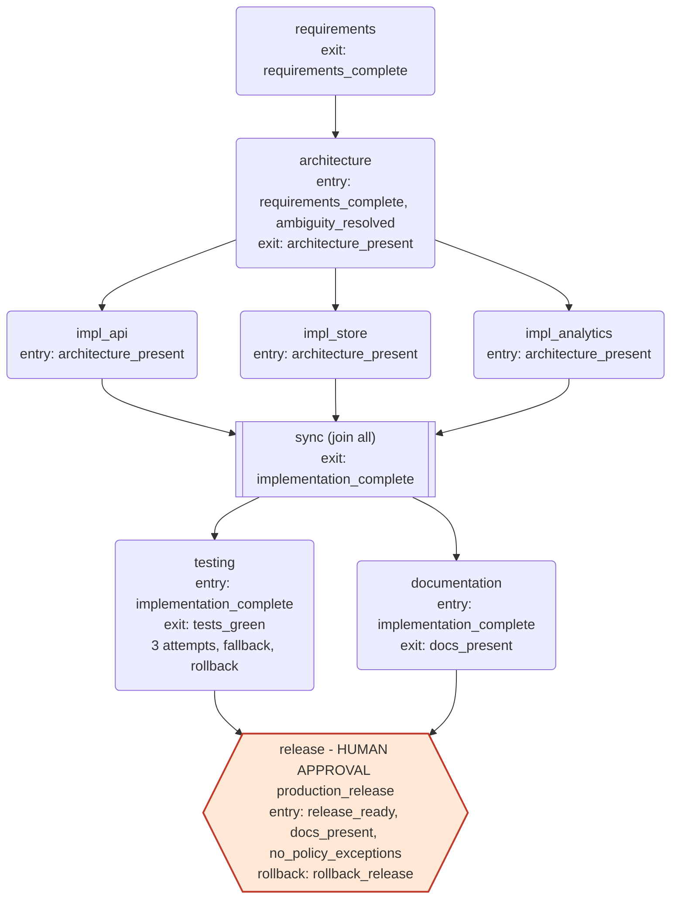
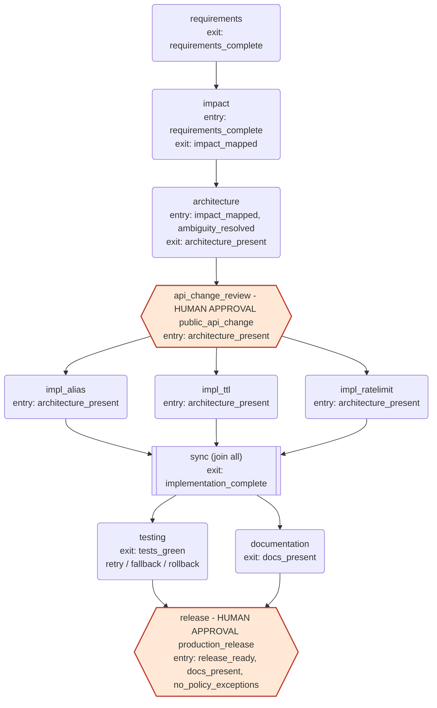
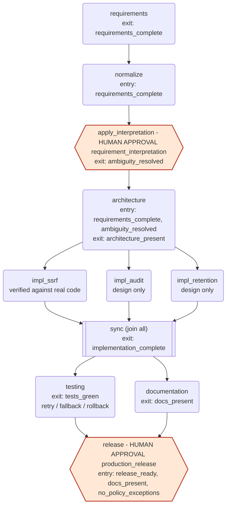

# Scenarios: what each one does, with real output

Three scenarios run on the same engine and the same shortener product. Everything below was produced by running the commands shown on 2026-10-10 in this repository; excerpts are trimmed, never edited. Run ids and millisecond timings differ on every run. Background: [README.md](../README.md) for commands, [ARCHITECTURE.md](../ARCHITECTURE.md) for semantics.

| | Greenfield | Brownfield | Ambiguous |
|---|---|---|---|
| Input | clear spec for a new service | extend an existing service | `Make links safer` |
| Stages | 9 | 11 | 11 |
| Parallel groups | 3 `impl_*` checks, then `testing` with `documentation` | same | same |
| Human checkpoints | `production_release` | `public_api_change`, `production_release` | `requirement_interpretation`, `production_release` |
| What it shows | the baseline pipeline | codebase reasoning, API-change review | ambiguity handling that cannot be skipped, honest design-only output |
| Real run shown below (`--skip-pytest`) | 9/9 succeeded, 183 ms, auto-approved (demo mode) | 11/11 succeeded, two human approvals | 11/11 succeeded, two human approvals |

Conventions in the graphs: a rounded box is a stage; a hexagon is a stage behind a human approval; `entry:` and `exit:` list the gates; a double-border box is a join (`join=all`).

Shared tail of every scenario (`scenarios/common.py`):

```text
impl_* (parallel) -> sync (join all, exit: implementation_complete)
sync -> testing        (entry: implementation_complete; exit: tests_green;
                        3 attempts, backoff 50 ms doubling, fallback testing_fallback,
                        rollback rollback_testing, 120 s timeout per attempt)
sync -> documentation  (entry: implementation_complete; exit: docs_present)
testing + documentation -> release  (entry: release_ready, docs_present, no_policy_exceptions;
                        approval production_release, autonomy human_gated,
                        1 attempt, rollback rollback_release)
```

---

## 1. Greenfield

### Input requirement

```text
Build a URL shortener service. Users create short links through a REST API, optionally with an expiry
time (ttl). Visiting a short link redirects to the destination and records the click. Owners can read
click analytics: total clicks, clicks per day, top referrers and unique visitors. Link creation is rate limited.
```

### Requirement understanding (artifact `requirements`, run `run-c398ac8d`)

The requirements agent matched three features in the text (`ttl`, `analytics`, `rate_limit`) and produced 3 goals, 10 acceptance criteria, 6 non-goals and 5 assumptions, with no open questions and `ambiguity.is_ambiguous: false`:

```text
goals:
  - Let links stop working after a chosen time
  - Show owners how their links are used without storing personal data
  - Protect link creation from abuse
acceptance_criteria (3 of 10):
  - Given a link created with ttl_seconds=60, When 61 seconds pass and the short URL is visited, Then the response is 410 expired
  - Given a client has sent 30 create requests in 60 seconds, When it sends another, Then the response is 429 rate_limited with a Retry-After header
  - Given any rejected request, When the API answers, Then the body is {error: {code, message}} with a 4xx status
non_goals: A web UI | Multi-tenant accounts or billing | Automatic deletion of expired links | Per-click geolocation | ...
assumptions: ... | The maximum ttl is 31536000 seconds (365 days) | Visitor identity is approximated by a hashed client IP | ...
```

This is a rule-based extraction (regex feature table), not model reasoning; see ARCHITECTURE.md section 13. Note what it did not detect: "REST API" and "redirect" are not features in the table, so no feature is generated for them; the `impl_api` and `impl_store` checks are part of the scenario graph regardless.

### Decomposition



### Orchestration walkthrough (real run)

Command: `python -m scenarios greenfield --auto-approve --skip-pytest` (the banner `*** DEMO MODE: all approvals auto-granted (no human review) ***` is printed first).

```text
Run run-c398ac8d  scenario=greenfield  state=SUCCEEDED

STAGE           STATE      MS   ATTEMPTS  GATES (passed/total)  APPROVAL
requirements    succeeded  3    1         exit 1/1              -
architecture    succeeded  0    1         entry 2/2, exit 1/1   -
impl_api        succeeded  106  1         entry 1/1             -
impl_store      succeeded  28   1         entry 1/1             -
impl_analytics  succeeded  18   1         entry 1/1             -
sync            succeeded  0    1         exit 1/1              -
testing         succeeded  65   1         entry 1/1, exit 1/1   -
documentation   succeeded  29   1         entry 1/1, exit 1/1   -
release         succeeded  9    1         entry 3/3             production_release: approved by demo-auto-approver

Metrics: e2e=183 ms, stages_ok=9, stages_failed=0, retries=0, fallbacks=0, rollbacks=0, approvals=1, replans=0
```

Decision lineage (`python -m scenarios trace run-c398ac8d`, trimmed). Note the three `impl_*` stages start at the same millisecond (parallel), `sync` starts only after the slowest finishes (join), and `testing` and `documentation` start together:

```text
+MS  KIND      STAGE           OUTCOME    RATIONALE
  0  start     -               created    run created for scenario 'greenfield' with 9 stages
  7  stage     requirements    started    stage started (execution #1)
 10  gate      requirements    pass       requirements are complete
 10  artifact  requirements    published  artifact 'requirements' published
 10  gate      architecture    pass       requirements are complete
 10  gate      architecture    pass       all open questions are resolved
 10  gate      architecture    pass       architecture defines 7 component(s)
 10  stage     impl_api        started    stage started (execution #1)
 10  stage     impl_store      started    stage started (execution #1)
 10  stage     impl_analytics  started    stage started (execution #1)
 28  stage     impl_analytics  succeeded  stage succeeded
 38  stage     impl_store      succeeded  stage succeeded
116  stage     impl_api        succeeded  stage succeeded
116  gate      sync            pass       implementation status is ok
116  stage     testing         started    stage started (execution #1)
116  stage     documentation   started    stage started (execution #1)
145  gate      documentation   pass       documentation has 3 file(s)
180  gate      testing         pass       6 test(s) passed, 0 failed
180  gate      release         pass       tests green and no failed stages
180  gate      release         pass       no unapproved policy exceptions
180  approval  release         requested  approval 'production_release' requested for stage 'release'
180  approval  release         approved   auto-approved by the engine's AutoApprovePolicy (demo-auto-approver)
189  finish    -               succeeded  run finished as succeeded
```

### Validation performed

- Gates: 15 gate evaluations passed in the run above; each is a decision record naming the gate and phase.
- `impl_api` (8 checks), `impl_store` (6) and `impl_analytics` (7) call the real shortener code and record `{check, input, expected, actual, ok}` for each, for example "create returns 201", "soft delete keeps the record", "visitor hash never contains the IP". `sync` merges them into `implementation` and raises if any part failed.
- `testing` with the real suite (`python -m scenarios greenfield --auto-approve`, no `--skip-pytest`): `test_report` has 211 passed, 0 failed (205 from `pytest tests/shortener` in a subprocess in 5,864 ms, plus 6 in-process smoke checks), end-to-end 6,082 ms. With `--skip-pytest` the report has the 6 smoke checks only; that is why the run above says "6 test(s) passed".
- `documentation` writes `CHANGELOG.md`, `API.md`, `DESIGN.md` to `docs/generated/<run_id>/`; `release` builds a go/no-go checklist from the run's own evidence and writes `RELEASE_CHECKLIST.md`.
- Every published artifact passes the policy engine (no secrets, no unsafe URL schemes).

### Risks and failure paths demonstrated

See section 4 for `testing`, `testing_hard` and `testing_all` injected into this scenario, with real output. Release rejection (below) is demonstrated here:

```text
$ python -m scenarios greenfield --skip-pytest            # no --auto-approve: pauses
PAUSED: run run-1db74614 is waiting for approval 'release-1' (production_release) at stage 'release'.
  - tests: 6 passed, 0 failed
  - documentation: 3 file(s)
$ python -m scenarios resume run-1db74614 --reject release-1 --actor dana --comment "hold the release until the rate-limit window is reviewed"
Run run-1db74614  scenario=greenfield  state=FAILED
release         failed     -    0         entry 3/3             production_release: rejected by dana
Errors:
  release: approval rejected by dana: hold the release until the rate-limit window is reviewed
Metrics: e2e=3480 ms, stages_ok=8, stages_failed=1, ...        (exit code 1)
```

The rollback agent does not run on a rejection: nothing was started, so there is nothing to undo.

### What a human decides

One checkpoint, at `release` (`production_release`): the approver sees test counts and documentation count and decides go or no-go. Approving runs the release stage; rejecting ends the run `failed` with the approver's name and comment in the record. In demo mode the engine answers instead, as `demo-auto-approver`, and the trail says so.

---

## 2. Brownfield

### Input requirement

```text
Extend the existing URL shortener: let users choose a custom alias for a link, support link expiry (ttl),
and rate limit link creation per client.
```

### Requirement understanding

Detected features `alias`, `ttl`, `rate_limit`; 3 goals, 10 acceptance criteria, no open questions. Example criteria for the new capability:

```text
- Given the alias 'promo' is taken, When another create uses it, Then the response is 409 alias_taken
- Given a reserved word such as 'api' or a malformed alias, When create is called, Then the response is 422 (reserved_alias / invalid_alias)
```

### Codebase reasoning (artifact `impact`)

This is what distinguishes the brownfield scenario. The impact agent parsed the real `shortener/` package with `ast` (63 functions in 8 files), built a name-based call graph, and traced each feature from its HTTP handler to the code it relies on:

```text
impacted_modules: app, ratelimit, service, store, validation          (5 modules)
call_traces (3 of 9):
  alias       POST /api/v1/urls -> app.create_url -> service.UrlService.create -> validation.validate_alias
  ttl         GET /{code} -> app.redirect -> service.UrlService.resolve_redirect -> service.is_expired
  rate_limit  POST /api/v1/urls -> app.create_url -> app.enforce_rate_limit -> ratelimit.RateLimiter.check
existing_support: alias implemented=true, ttl implemented=true, rate_limit implemented=true
regression_risks (3 of 6):
  - A new top-level route silently collides with an existing alias
  - PATCH ttl_seconds counts from 'now', which can surprise clients
  - Clients can rotate X-API-Key values to evade the limit
tests_to_rerun: tests/shortener/test_api.py, test_manifest.py, test_ratelimit.py, test_store.py, test_validation.py
public_api_changes: 3, all breaking=false          requires_approval: true (public_api_change)
```

The finding that all three features already exist is itself the result: the `architecture` agent marks every component `new: false`, and the "implementation" stages verify the existing code rather than build. The call graph matches calls by name only (`x.add()` matches every `add`), so the traces are an over-approximation of what a change might touch, not a type-checked proof.

### Decomposition



### Orchestration walkthrough (real run, two processes plus a third)

Process 1: `python -m scenarios brownfield --skip-pytest`. The run stops at the first human checkpoint and exits with code 0 (waiting is not a failure):

```text
Run run-99285371  scenario=brownfield  state=WAITING_APPROVAL

STAGE              STATE             MS  ATTEMPTS  GATES (passed/total)  APPROVAL
requirements       succeeded         12  1         exit 1/1              -
impact             succeeded         30  1         entry 1/1, exit 1/1   -
architecture       succeeded         6   1         entry 2/2, exit 1/1   -
api_change_review  waiting_approval  -   0         entry 1/1             public_api_change: pending
impl_alias         pending           -   0         -                     -
...
PAUSED: run run-99285371 is waiting for approval 'api_change_review-1' (public_api_change) at stage 'api_change_review'.
  - [alias] POST /api/v1/urls accepts an optional 'alias'; adds 409 alias_taken, 422 invalid_alias and reserved_alias
  - [ttl] POST and PATCH accept ttl_seconds; GET /{code} returns 410 expired after expiry
  - [rate_limit] POST /api/v1/urls may answer 429 with a Retry-After header
  approve: python -m scenarios resume run-99285371 --approve api_change_review-1 --actor you
```

Process 2 (a brand new process; state comes from SQLite): `python -m scenarios resume run-99285371 --approve api_change_review-1 --actor you`. The three `impl_*` stages run in parallel, `sync` joins, `testing` and `documentation` run in parallel, and the run pauses again, at the release:

```text
api_change_review  succeeded  6   1  entry 1/1             public_api_change: approved by you
impl_alias         succeeded  11  1  entry 1/1             -
impl_ttl           succeeded  13  1  entry 1/1             -
impl_ratelimit     succeeded  92  1  entry 1/1             -
sync               succeeded  5   1  exit 1/1              -
testing            succeeded  113 1  entry 1/1, exit 1/1   -
documentation      succeeded  39  1  entry 1/1, exit 1/1   -
release            waiting_approval  -  0  entry 3/3        production_release: pending
PAUSED: run run-99285371 is waiting for approval 'release-1' (production_release) at stage 'release'.
  - tests: 6 passed, 0 failed
  - documentation: 3 file(s)
```

Process 3: `python -m scenarios resume run-99285371 --approve release-1 --actor you --comment "checklist reviewed"` finishes the run. The relevant part of the lineage, showing both pauses and resumes:

```text
+MS    KIND      STAGE              OUTCOME    RATIONALE
   50  approval  api_change_review  requested  approval 'public_api_change' requested for stage 'api_change_review'
   50  approval  -                  paused     run paused until pending approvals are resolved
 5349  approval  api_change_review  approved   approved by you
 5354  start     -                  resumed    run resumed
 5354  gate      api_change_review  pass       architecture defines 7 component(s)     <- entry gate re-checked after approval
 5361  stage     impl_alias         started    stage started (execution #1)
 5361  stage     impl_ttl           started    stage started (execution #1)
 5362  stage     impl_ratelimit     started    stage started (execution #1)
 5461  stage     testing            started    stage started (execution #1)
 5461  stage     documentation      started    stage started (execution #1)
 5575  approval  release            requested  approval 'production_release' requested for stage 'release'
10149  approval  release            approved   checklist reviewed
10166  finish    -                  succeeded  run finished as succeeded
```

Metrics for this run (`python -m scenarios metrics run-99285371 --json`):

```text
e2e_latency_ms 10163.9    approval_wait_ms 9874.5    active_ms 289.4
```

The end-to-end figure is dominated by the time humans took; `active_ms` is the time the system itself worked (see ARCHITECTURE.md section 10).

### Validation performed

- `impl_alias` (7 checks), `impl_ttl` (8) and `impl_ratelimit` (7) exercise the existing code: alias format, length and reserved words, alias conflict, ttl bounds and exact expiry boundary, rate-limit window and the HTTP 429 with `Retry-After`. All 22 passed.
- `api_change_review` records exactly what the human approved: 3 changes, `breaking: false`, `backward_compatible: true`.
- The release checklist lists approvals required (`production_release`, `public_api_change`), open risks and a rollback plan.
- Gates, policy and the testing stage behave as in greenfield.

### Risks and failure paths demonstrated

Rejecting the API review stops everything downstream (real output):

```text
$ python -m scenarios resume run-658ffefd --reject api_change_review-1 --actor carol --comment "alias namespace collides with reserved routes; resubmit"
Run run-658ffefd  scenario=brownfield  state=FAILED
api_change_review  failed   -  0  entry 1/1  public_api_change: rejected by carol
impl_alias, impl_ttl, impl_ratelimit, sync, testing, documentation, release   skipped
Errors:
  api_change_review: approval rejected by carol: alias namespace collides with reserved routes; resubmit
```

Seven stages are `skipped` with the decision "an upstream stage failed or was skipped"; nothing was verified or documented against a change a human refused. The exit code is 1.

Safe-stop of a paused run, over HTTP (`POST /runs/run-28639047/stop`, real output):

```text
state: stopped   stop_requested: True
requirements, impact, architecture: succeeded
api_change_review, impl_alias, impl_ttl, impl_ratelimit, sync, testing, documentation, release: skipped
approval api_change_review-1: rejected by 'engine', comment 'run stopped'
a second POST /stop -> 409 run_already_finished
```

### What a human decides

1. `public_api_change`: the reviewer is shown the three API deltas and decides whether to accept the contract change before any verification or documentation runs. Approving unlocks the parallel stages; rejecting ends the run.
2. `production_release`: the reviewer sees test counts and documentation, and the generated checklist is on disk. Approve to complete, reject to end the run `failed`.

Both decisions need a named actor, and the names are recorded in the approval and in the decision lineage. Over HTTP the same two checkpoints are `POST /runs/{id}/approvals/api_change_review-1/approve` and `.../release-1/approve`.

---

## 3. Ambiguous

### Input requirement

```text
Make links safer
```

### Requirement understanding (artifact `requirements`, run `run-1687ff40`)

No concrete capability matches, so the agent refuses to guess. It flags the request as ambiguous, names the vague term, and turns the ambiguity into four explicit open questions with empty resolutions:

```text
problem: Stakeholders asked: "Make links safer". No concrete capability could be identified, so the intent is ambiguous (vague terms: safer).
goals:   Agree what the request means before any design or code is written
detected_features: []     ambiguity: {is_ambiguous: true, vague_terms: ["safer"]}
open_questions (resolution is empty on every one):
  scope          Which kind of harm should the change protect against: unsafe destinations (SSRF, dangerous schemes), abuse of link creation, or visitor privacy?
  accountability Must changes to links be traceable to an actor (audit trail)?
  privacy        How long may click data (hashed visitor, referrer) be kept?
  compatibility  May existing API behaviour or response shapes change?
```

The `normalize` agent then proposes one bounded answer per question, and nothing is resolved yet (`interpretation_status: proposed`). The proposals come from a fixed table keyed by topic, so they are reasoned-out defaults, not model output:

```text
scope          proposed: Destination safety first: harden the SSRF and scheme guard on create and update. Abuse limits already exist (rate limiting) and are out of scope.
accountability proposed: Yes: an append-only audit entry for create, update and delete, with a hashed actor, never a raw key or IP. Design only in this iteration.
privacy        proposed: Purge clicks and deleted links older than 90 days. No change to the public API.
compatibility  proposed: No: the change must be backward compatible and add no new endpoints.
```

### Decomposition



There are two independent guards against building on an unresolved request: the human approval on `apply_interpretation`, and the `ambiguity_resolved` gate, which is both its exit gate and an entry gate of `architecture`. A test removes the clarification stages from the graph and shows that `architecture` is then `blocked` by its own `ambiguity_resolved` entry gate, with the whole delivery skipped (`test_the_ambiguity_gate_cannot_be_skipped`).

### Orchestration walkthrough (real run, `run-1687ff40`)

`python -m scenarios ambiguous --skip-pytest` pauses after two stages, and prints the review material so the approver sees what they are accepting (the four proposals above):

```text
Run run-1687ff40  scenario=ambiguous  state=WAITING_APPROVAL
requirements          succeeded         3  1  exit 1/1   -
normalize             succeeded         9  1  entry 1/1  -
apply_interpretation  waiting_approval  -  0  -           requirement_interpretation: pending
architecture ... release   pending
PAUSED: run run-1687ff40 is waiting for approval 'apply_interpretation-1' (requirement_interpretation) at stage 'apply_interpretation'.
```

Resume, as `alice`, with a comment (`resume run-1687ff40 --approve apply_interpretation-1 --actor alice --comment "bounded interpretation accepted"`):

```text
apply_interpretation  succeeded  8  1  exit 1/1  requirement_interpretation: approved by alice
architecture          succeeded  5  1  entry 2/2, exit 1/1
impl_ssrf / impl_audit / impl_retention   succeeded (parallel)
sync, testing, documentation   succeeded       release   waiting_approval
```

```text
+MS    KIND      STAGE                 OUTCOME    RATIONALE
   22  approval  apply_interpretation  requested  approval 'requirement_interpretation' requested for stage 'apply_interpretation'
13294  approval  apply_interpretation  approved   bounded interpretation accepted
13306  gate      apply_interpretation  pass       all open questions are resolved          <- exit gate: the ambiguity is now closed
13307  gate      architecture          pass       requirements are complete
13307  gate      architecture          pass       all open questions are resolved          <- entry gate, evaluated independently
```

Then `resume ... --approve release-1 --actor bob` finishes the run as `succeeded`.

The artifact `normalized_requirements` goes to version 2 after the approval: all four questions have `status: resolved`, `detected_features` is now `ssrf, audit, retention`, and acceptance criteria for those features were appended. The architecture then contains 7 components including `destination_guard`, `audit_log` and `retention_job`, and 4 ADRs.

### Validation performed

- `impl_ssrf` runs 13 checks against the real destination validator: 12 unsafe destinations are rejected (127.0.0.1, `localhost`, decimal `2130706433`, hex `0x7f000001`, `[::1]`, `169.254.169.254`, `10.0.0.5`, `*.internal`, `ftp:`, `javascript:`, `file:`, embedded credentials) and one normal https URL is accepted. All 13 passed. It also carries the product's known limitation: no DNS resolution, so a hostname that resolves to a private IP is not caught.
- `impl_audit` and `impl_retention` find no code to verify, and say so. They publish a design with `design_only: true` and `verified: false`; their only evidence concerns the code they would build on (2 and 3 checks). `sync` reports `verified_parts: [ssrf]`, `design_only_parts: [audit, retention]`.
- The release checklist is `go`, and its open risks include `'audit' is design only: nothing was built or executed` and `'retention' is design only: nothing was built or executed`, followed by the product's known limitations.

This is the honest-output point of the scenario: the pipeline reaches a green release decision, but the artifact trail does not claim that audit logging or retention exist.

### Risks and failure paths demonstrated

Rejecting the interpretation fails the run before any design (real output):

```text
$ python -m scenarios resume run-ce6b8f78 --reject apply_interpretation-1 --actor carol
Run run-ce6b8f78  scenario=ambiguous  state=FAILED
apply_interpretation  failed   -  0  -  requirement_interpretation: rejected by carol
architecture, impl_ssrf, impl_audit, impl_retention, sync, testing, documentation, release   skipped
```

Failure injection on this scenario works the same way as on greenfield (section 4). Real results:

```text
ambiguous --inject-failure testing      run-7b202efa  SUCCEEDED    testing: 2 attempts, retries=1
ambiguous --inject-failure testing_all  run-c8a3d9bd  ROLLED_BACK  testing: rolled_back (4 attempts, fallback), retries=2, fallbacks=1, rollbacks=1,
                                                      release skipped, exit code 1
```

### What a human decides

1. `requirement_interpretation`: whether the four proposed answers are the right reading of "Make links safer". The approver can accept or reject; they cannot edit a proposal in this build (to change one, reject and start a new run with a sharper requirement).
2. `production_release`: as before; here the checklist makes the design-only parts visible, so the approver knows audit logging and retention are plans, not features.

---

## 4. Failure injection: retry, fallback, rollback

The testing stage is where the ladder is shown. The flag `--inject-failure` is read by the testing agents only (`orchestrator/agents/testing.py`). Commands and real results on greenfield (`--auto-approve --skip-pytest`):

| Command flag | Run | Testing stage result | Run result | Metrics line |
|---|---|---|---|---|
| `--inject-failure testing` | `run-f6b479be` | `succeeded`, 2 attempts | `SUCCEEDED` | retries=1 fallbacks=0 rollbacks=0 |
| `--inject-failure testing_hard` | `run-5546fead` | `succeeded`, 4 attempts, `(fallback)` | `SUCCEEDED` | retries=2 fallbacks=1 rollbacks=0 |
| `--inject-failure testing_all` | `run-2e002f28` | `rolled_back`, 4 attempts, `(fallback)` | `ROLLED_BACK`, exit code 1 | retries=2 fallbacks=1 rollbacks=1 |

### `testing`: transient failure, retry with backoff

```text
171  retry  testing  failed     attempt 1/3 with 'testing' failed: injected transient test failure
171  retry  testing  scheduled  retrying in 50 ms
281  gate   testing  pass       6 test(s) passed, 0 failed
281  stage  testing  succeeded  stage succeeded
...  finish -        succeeded  run finished as succeeded
```

### `testing_hard`: retries exhausted, fallback agent

```text
132  retry     testing  failed     attempt 1/3 with 'testing' failed: injected permanent test failure
132  retry     testing  scheduled  retrying in 50 ms
201  retry     testing  failed     attempt 2/3 with 'testing' failed: injected permanent test failure
201  retry     testing  scheduled  retrying in 100 ms
307  retry     testing  failed     attempt 3/3 with 'testing' failed: injected permanent test failure
307  fallback  testing  attempted  retries exhausted; trying fallback agent 'testing_fallback'
326  gate      testing  pass       3 test(s) passed, 0 failed
326  stage     testing  succeeded  stage succeeded
```

The backoff doubles (50 ms, then 100 ms). Worth noticing: the fallback is a cheaper check (3 smoke checks, no pytest subprocess), and the `tests_green` gate accepts it because it only checks counts. The run succeeds with weaker evidence; the release approver would see `tests: 3 passed`. That is a deliberate trade-off of having a fallback, and the evidence is visible in the artifact, but the gate does not distinguish the two.

### `testing_all`: fallback also fails, rollback, release never starts

```text
318  fallback  testing  attempted  retries exhausted; trying fallback agent 'testing_fallback'
318  retry     testing  failed     attempt 1/1 with 'testing_fallback' failed: injected fallback failure
318  rollback  testing  applied    stage failed (injected fallback failure); rollback agent 'rollback_testing' ran
318  stage     release  skipped    an upstream stage failed or was skipped
318  finish    -        rolled_back  run finished as rolled_back

STAGE          STATE        ATTEMPTS
testing        rolled_back  4 (fallback)
documentation  succeeded    1                <- independent branch was not affected
release        skipped      0                <- never asked for approval
Errors:  testing: injected fallback failure
```

No `test_report` was published, so the `release_ready` gate could not pass even if the release stage were reached. The `rollback_testing` agent records exactly that.

### Aggregate metrics after the four ambiguous and injection runs

`python -m scenarios metrics` over a database holding `run-1687ff40` (ambiguous, human-approved) and the three injection runs:

```text
runs_started 4    runs_succeeded 3    runs_rolled_back 1    success_rate 0.75
retries_total 5   retry_rate_per_run 1.25   fallbacks_total 2   rollbacks_total 1   rollback_rate 0.25
mttr_ms 165.8     avg_e2e_latency_ms 3972.7   avg_active_ms 268.2   p95_e2e_latency_ms 14977.9
```

`mttr_ms` is the mean over the two succeeded runs that needed recovery (`run-f6b479be`, `run-5546fead`); the rolled-back run and the clean run contribute no sample. The e2e average and p95 are large because the ambiguous run waited for two humans, which is why `avg_active_ms` exists. MTTR here is an approximation as defined in ARCHITECTURE.md section 10.

---

## 5. Paths proven by tests rather than by the CLI

Some behaviours cannot be triggered from the scenarios' command line. They are covered by the engine tests and, where useful, were run directly:

| Behaviour | How it was shown |
|---|---|
| Policy hard stop (secret in an artifact) | Ran an engine with an agent returning `{"db": {"password": "..."}}`, a stage `max_attempts=3` and a fallback agent: the stage is `failed` after 1 attempt, no retry, no fallback; decision `policy fail: literal secret value found in artifact 'config' field 'db.password'`, then `stop requested: policy violation triggered an automatic safe-stop`; the dependent stage is `skipped`; run `failed`. Test: `test_secret_in_artifact_is_a_hard_stop_with_no_retry`, `test_policy_violation_safe_stops_other_branches`. |
| Stage-definition violations | `create_run` raises before a run exists; over HTTP: 422 `policy_violation`. Test: `test_create_run_rejects_policy_violating_stage`, `test_create_run_policy_violation_is_422`. |
| Safe-stop with an in-flight stage | The in-flight stage finishes, later attempts, fallback and rollback do not launch, the run ends `stopped`. Tests: `test_stop_lets_inflight_stage_finish_and_skips_the_rest`, `test_stop_skips_remaining_retries_and_the_run_ends_stopped_not_failed`, `test_stop_does_not_launch_the_rollback_agent_and_the_stage_counts_as_failed`. |
| Re-plan on a changed upstream artifact, and the cap | Tests in `tests/orchestrator/test_engine.py` (`test_replan_*`). No scenario triggers it; their metrics show `replans=0`. |
| Timeout of an attempt | `test_agent_timeout_fails_the_attempt_and_counts_toward_retries`. The `testing` stage carries a 120 s timeout in every scenario (`test_scenario_testing_stages_have_a_timeout`). |
| Clients cannot enable demo mode | Real server: `POST /runs` with `params.auto_approve` answers 422 `auto_approve_not_allowed`; `{"actor":"system"}` answers 422 `invalid_actor`. Tests: `test_client_cannot_enable_auto_approve_through_run_params`, `test_reserved_actor_names_cannot_approve_or_reject_over_http`. |
| A run survives an orchestrator restart | Real server: created a brownfield run over HTTP, approved the first checkpoint, killed the server process, restarted it; `GET /runs/{id}` still showed `waiting_approval` with `release-1` pending, and approving it finished the run `succeeded`. Test: `test_run_survives_restart_via_shared_store`. |

One observation from that restart: after the restart, `GET /metrics` showed `runs_started: 0` with `runs_succeeded: 1`, and the telemetry half of `/runs/{id}/trace` held only the new process's 9 events while the `decisions` list held all 66. The decision lineage and `data/audit.jsonl` keep the full history; the in-memory aggregates restart.
